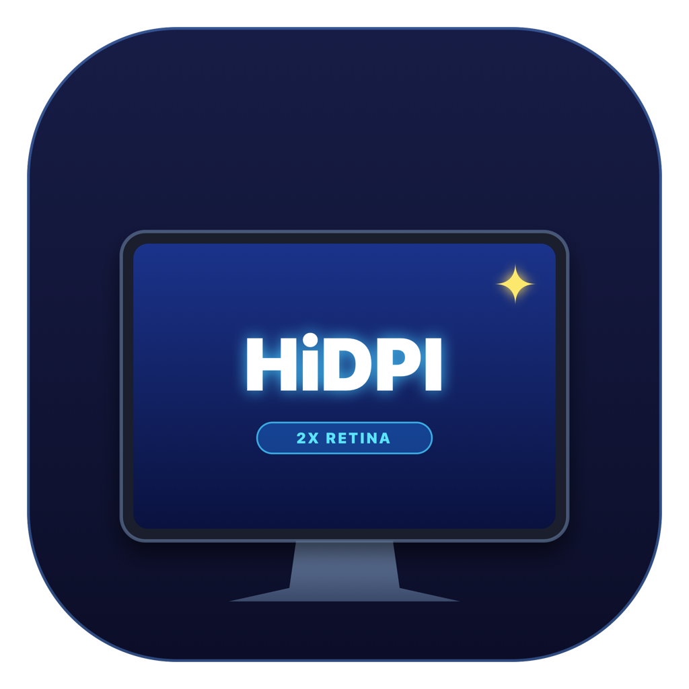

# HiDpiSwitcher

<p align="center">
  
</p>

<p align="center">
  <b>A lightweight, zero-overhead macOS menu bar utility for native HiDPI (Retina 2x) switching, virtual display supersampling, and refresh rate management.</b>
</p>

<p align="center">
  <a href="https://github.com/banzaez/hidpi-switcher/releases"></a>
  <a href="https://developer.apple.com/macos/"></a>
  <a href="https://swift.org"></a>
  <a href="https://github.com/banzaez/hidpi-switcher/blob/main/LICENSE"></a>
  <a href="https://github.com/banzaez/hidpi-switcher"></a>
  <a href="https://github.com/banzaez/hidpi-switcher"></a>
</p>

<p align="center">
  <b>English</b> | <a href="README_RU.md">Русский</a>
</p>

---

## Why HiDpiSwitcher?

macOS is engineered around ultra-dense Retina displays (~218 pixels per inch). When connected to standard external monitors—such as **2K / QHD (2560×1440)**, **Ultrawide (3440×1440, 5120×1440)**, or non-integer 4K scaling setups—macOS often disables true HiDPI rendering. The result is blurry text, fuzzy UI elements, or awkward UI sizing.

Standard macOS System Settings offer little control:
- No fast way to toggle HiDPI modes on the fly.
- Resolution menus are cluttered with dozens of identical resolutions repeating at different refresh rates (`60Hz`, `100Hz`, `144Hz`).
- No safety net if an unsupported display mode causes a black screen ("Out of Range").
- Enabling HiDPI on 1440p displays conventionally required either disabling System Integrity Protection (SIP) or running resource-heavy background processes.

**HiDpiSwitcher** solves these challenges with a focused, native, open-source Menu Bar app. Built from the ground up in **pure Swift 6**, it uses direct SkyLight CGS private interfaces and native virtual display pipelines to give you crystal-clear Retina rendering, decoupled refresh rate selection, and instant failure-proof switching.

---

## Feature Comparison

| Capability | macOS System Settings | Heavy Third-Party Tools | HiDpiSwitcher |
| :--- | :---: | :---: | :---: |
| **Instant 1-Click / Hotkey HiDPI Switch** | ❌ No | ⚠️ Partial | ✅ **Yes (`⌃⌥⌘H`)** |
| **Clean Resolution / Refresh Rate Separation** | ❌ Mixed list | ⚠️ Cluttered menus | ✅ **Dedicated Submenu** |
| **HiDPI on 2K / Ultrawide without SIP Disabling** | ❌ Unsupported | ⚠️ Kernel/Daemon based | ✅ **Yes (`CGVirtualDisplay`)** |
| **10-Second Auto-Rollback Protection** | ❌ Black screen risk | ❌ Rare | ✅ **Yes (Interactive NSPanel)** |
| **Resource Usage** | N/A | ~80–200 MB RAM | **< 15 MB RAM / 0% CPU idle** |
| **External Dependencies** | System | Multiple frameworks | **Zero (Pure Swift 6)** |
| **Open Source & Privacy-Focused** | Proprietary | Often proprietary/paid | ✅ **100% MIT Open Source** |

---

## Core Capabilities

### 1. Instant HiDPI Toggle & Mode Pairing (`⌃⌥⌘H`)
Quickly toggle between 1x standard resolution and 2x Retina mode. HiDpiSwitcher pairs corresponding display modes intelligently (e.g., `3840×2160 1x ↔ 1920×1080 2x`) while strictly maintaining your configured refresh rate.

### 2. Decoupled Resolution and Refresh Rate Controls
Instead of a bloated list with redundant entries for every frequency, HiDpiSwitcher groups modes strictly by geometric aspect ratio. Refresh rates (`60Hz`, `100Hz`, `120Hz`, `144Hz`, `240Hz`, or ProMotion) are selected in an independent **Refresh Rate** submenu, filtered against the monitor's native panel capabilities to prevent signal distortion.

### 3. Dual-Engine HiDPI Unlock for 2K & Ultrawide Panels
- **Engine A: Instant Virtual Framebuffer (`CGVirtualDisplay` + Hardware Mirroring)**  
  Creates a virtual Retina buffer paired with hardware display mirroring. Requires **no system reboot** and **no SIP tampering**. It unlocks fractional supersampling presets (e.g., `2752×1152 HiDPI` on 3440×1440 Ultrawides, `2048×1152 HiDPI` on 2560×1440 2K panels) for razor-sharp typography.
- **Engine B: Native System Display Override Generator**  
  Generates optimized binary `scale-resolutions` plists (triplicates: base 8-byte, HiDPI 16-byte, and scaled Retina 16-byte records) in `/Library/Displays/Contents/Resources/Overrides` for persistent driver-level recognition.

### 4. Interactive 10-Second Rollback Safety Dialog
Switching to an unverified mode triggers a floating countdown panel:
- Press <kbd>Enter</kbd> or click **Keep** to accept the mode.
- Press <kbd>Esc</kbd> or click **Revert** to immediately restore the prior mode.
- If your panel loses synchronization ("Out of Range" or black screen), the previous mode is automatically restored when the 10-second timer expires.
- An optional setting, *"Always confirm mode changes"*, enables this safeguard for all resolution switches.

### 5. Favorite Presets & Fast Cycling (`⌃⌥⌘F`)
Star frequently used configurations (e.g. your primary workspace scaling vs. screen-sharing presentations) to pin them at the top of the menu. Rapidly cycle through favorites at any time using the global shortcut <kbd>⌃</kbd> <kbd>⌥</kbd> <kbd>⌘</kbd> <kbd>F</kbd>.

### 6. Built-in Safety & Display Protection
- **MacBook Built-in Retina Protection**: Guardrails automatically prevent accidental virtual display mirroring or override creation on internal MacBook screens.
- **Portrait & Rotated Display Support**: Seamlessly accommodates portrait orientations (e.g., `1080×1920`) with dedicated ratio filtering.
- **Aspect Ratio Delta Filtering**: Filters out distorted 4:3 modes on 21:9 monitors and suppresses oversized internal backing buffers.

### 7. Integrated In-App Auto-Updater
- Checks the GitHub Releases API (`banzaez/hidpi-switcher`) in the background or on demand.
- Native update window built with AppKit/SwiftUI showing release notes and download progress.
- Atomic `.app` bundle replacement with quarantine attribute removal (`com.apple.quarantine`) and automatic relaunch.

---

## Keyboard Shortcuts

| Shortcut | Action | Description |
| :--- | :--- | :--- |
| <kbd>⌃</kbd> <kbd>⌥</kbd> <kbd>⌘</kbd> <kbd>H</kbd> | **Toggle HiDPI** | Instantly switches between 1x and 2x Retina mode for the active display |
| <kbd>⌃</kbd> <kbd>⌥</kbd> <kbd>⌘</kbd> <kbd>F</kbd> | **Cycle Favorites** | Steps forward through pinned favorite resolution presets |
| <kbd>Enter</kbd> | **Confirm Mode** | Confirms and saves the active mode in the rollback dialog |
| <kbd>Esc</kbd> | **Revert Mode** | Cancels and immediately restores the prior display mode |

*Note: Global shortcuts use Carbon's `RegisterEventHotKey` API and do not require macOS Accessibility permissions.*

---

## Architecture & Technical Design

HiDpiSwitcher follows clean architectural principles with strict separation of concerns:

```
Sources/
├── Domain/                         # Pure Swift business logic & models (No UI imports)
│   ├── DisplayModels.swift         # DisplayDevice, DisplayMode, ModeCatalog, ModeKey
│   ├── ModeResolver.swift          # Mode matching, deduplication & aspect ratio validation
│   ├── CustomHiDPISpec.swift       # Geometry calculation & scale-resolutions binary encoder
│   └── UpdateModels.swift          # SemVer 2.0 parser & release metadata
│
├── Infrastructure/                 # OS bridges, private APIs & hardware clients
│   ├── CGSPrivate.swift            # Zero-allocation SkyLight CGS symbols via @_silgen_name
│   ├── DisplayHardwareClient.swift # AsyncStream CoreGraphics display reconfiguration listener
│   ├── VirtualHiDPIService.swift   # CGVirtualDisplay lifecycle & hardware mirroring
│   ├── DisplayOverrideInstaller.swift # Root-assisted /Library/Displays plist management
│   ├── GlobalHotKeyService.swift   # Carbon RegisterEventHotKey bridge
│   ├── DisplayPreferencesStore.swift # Persistent settings & favorite modes in UserDefaults
│   └── GitHubUpdateService.swift   # URLSession release downloader, ditto extractor & relaunch script
│
├── Application/                    # State management & background orchestrators
│   ├── DisplayStore.swift          # MainActor @Observable store with display event debouncing
│   ├── LaunchAtLoginStore.swift    # Login item registration via modern SMAppService
│   └── UpdateStore.swift           # Automated 24h background checks & update state machine
│
└── Presentation/                   # Declarative SwiftUI & AppKit UI layer
    ├── HiDpiApp.swift              # MenuBarExtra application entry point
    ├── ModeMenu.swift              # Menu bar extra interface with toggle states & submenus
    ├── RevertConfirmationDialog.swift # Floating countdown modal window (NSPanel)
    ├── UpdateDialogView.swift      # Sparkle-style native update presenter & release notes
    └── DisplayFormatters.swift     # Localized resolution & refresh rate formatting helpers
```

### Engineering Highlights

- **Zero-Allocation SkyLight Private CGS API**: Direct bindings to Apple's private CGS display functions (`CGSGetCurrentDisplayMode`, `CGSConfigureDisplayMode`, `CGSGetNumberOfDisplayModes`, `CGSGetDisplayModeDescriptionOfLength`) using `@_silgen_name` and stack-allocated `CGSModeRaw` memory buffers (`0xD4` / `0xDC` byte layout). This avoids heap allocations and Objective-C runtime overhead when querying display modes.
- **Swift 6 Strict Concurrency**: All models conform to `Sendable`, background work is strictly isolated, and state stores are bound to `@MainActor`.
- **Swift Testing Suite**: 23 automated unit tests verifying CGS binary layouts, aspect ratio algorithms, mode grouping, portrait display logic, and SemVer update checks.

---

## Requirements

- **Operating System**: macOS 14.0 Sonoma, macOS 15.0 Sequoia, macOS 16.0 Tahoe or newer.
- **Hardware**: Apple Silicon (M1, M2, M3, M4, M5) or Intel Mac.
- **Permissions**: Standard user permissions. No Accessibility permissions required.

---

## Installation

### Pre-built Binary
Download the latest `HiDpiSwitcher-vX.Y.Z.zip` from [GitHub Releases](https://github.com/banzaez/hidpi-switcher/releases). Unpack the archive and move `HiDpiSwitcher.app` into `/Applications`.

### Build from Source

Requirements: Xcode 16+ or Command Line Tools with Swift 6 support.

```bash
# Clone the repository
git clone https://github.com/banzaez/hidpi-switcher.git
cd hidpi-switcher

# Run test suite (Swift Testing)
./build.sh test

# Build Universal Binary (arm64 + x86_64)
./build.sh

# Build and install directly to /Applications
./build.sh install
```

To sign with your own Developer ID certificate:
```bash
SIGN_IDENTITY="Developer ID Application: Your Name (TeamID)" ./build.sh
```

---

## FAQ

#### Why do 2K / 1440p and Ultrawide monitors look blurry on macOS?
macOS renders UI elements at 2x logical resolution and then scales down to physical pixels. On ~110 DPI panels (like standard 27" 2560×1440 monitors), macOS disables this mechanism by default and renders at 1x, which causes thin, blurry font rendering. HiDpiSwitcher restores true 2x Retina rendering and supersampling.

#### Does HiDpiSwitcher require disabling SIP (System Integrity Protection)?
No. The primary Virtual HiDPI engine (`CGVirtualDisplay` with hardware mirroring) works with SIP completely enabled and requires no root privileges.

#### How does the fail-safe rollback timer protect my monitor?
If a chosen resolution or refresh rate is not supported by your display hardware, you don't need to panic. If the confirmation dialog is not dismissed with `Enter` within 10 seconds, the previous working display mode is restored automatically.

---

## License

This project is licensed under the [MIT License](LICENSE).
